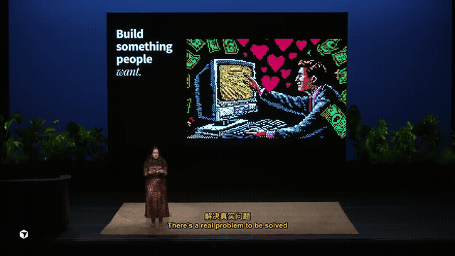
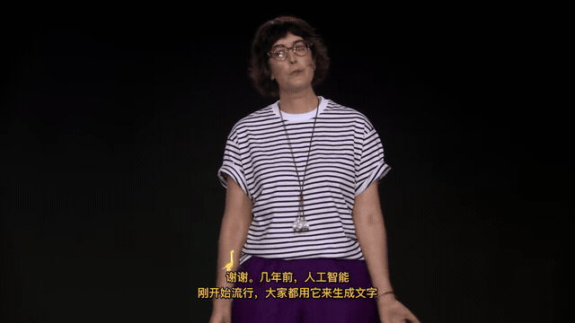
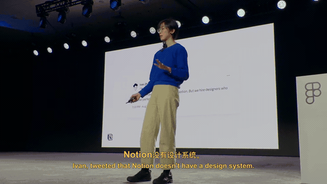
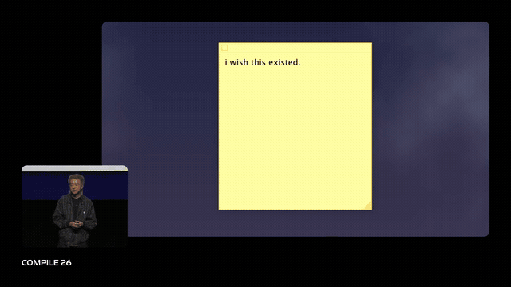
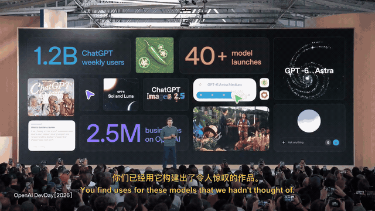

# 原片 → 中文译配 · 历史作品展示

这里先收录五组真实历史成片的短片段，供当前私有仓库查看效果。每组均提供官方原片链接、真实中文片段和无声动图；视频声音需点开 MP4 查看／下载。原片定位只作对应内容的浏览辅助，不承诺跨平台剪辑版本逐帧一致。

这些片段并非本仓库新 CLI 的批量复现证据，也不包含重新通过全量人耳验收的声明。历史作品可能使用单语字幕、独立时间轨或旧断句策略。当前代码能力与实际验收范围见 [验证记录](../VALIDATION.md)。

| 内容 | 原片 · 官方发布 | 中文译配 · 历史真实片段 |
|---|---|---|
| **ChatPRD · 新时代的产品经理** 历史中英字幕 |  [观看原片 · Cursor](https://www.youtube.com/watch?v=4CAFK-rc26A&t=75s) |  [查看／下载中文 MP4 · 约 38 秒](assets/pm-workflow/dubbed.mp4?raw=true) |
| **Anthropic · AI 时代的内容设计** 历史中文字幕 |  [观看原片 · Figma](https://www.youtube.com/watch?v=l5VRhrNeidY&t=13s) |  [查看／下载中文 MP4 · 约 55 秒](assets/content-design/dubbed.mp4?raw=true) |
| **Notion · 设计系统** 历史中英字幕 |  [观看原片 · Figma](https://www.youtube.com/watch?v=u7_Qof3AJ1g&t=30s) |  [查看／下载中文 MP4 · 约 45 秒](assets/design-system/dubbed.mp4?raw=true) |
| **Cursor · Closer to the Material** 历史中英字幕 |  [观看原片 · Cursor](https://www.youtube.com/watch?v=az6OEZV8iHw&t=15s) |  [查看／下载中文 MP4 · 约 45 秒](assets/software-craft/dubbed.mp4?raw=true) |
| **OpenAI · 开发者主题演讲** 历史中英字幕 |  [观看原片 · OpenAI](https://www.youtube.com/watch?v=Fls_onRviPM&t=30s) |  [查看／下载中文 MP4 · 约 45 秒](assets/developer-keynote/dubbed.mp4?raw=true) |

## 逐项来源与范围

### ChatPRD · 新时代的产品经理

- 原片：[The New PM, Claire Vo \| Compile 26](https://www.youtube.com/watch?v=4CAFK-rc26A)；发布者：[Cursor](https://www.youtube.com/@cursor_ai)。
- 历史成片截取：从约 75.27 秒开始，片段实际时长 37.505 秒；未重做配音或改动原归档。
- 显示样式：历史中英字幕。
- 来源与验证：官方 oEmbed 信息核对、归档文件哈希一致、片段完整解码及容器元数据检查；本次不是新的全片／人耳验收。
- 使用范围：仅私有预览；公开传播、素材和声音权利尚未统一清理，不授予 MIT 媒体许可。

### Anthropic · AI 时代的内容设计

- 原片：[Writing for humans in an AI world ft. Chelsea Larsson (Anthropic) \| Config 2026](https://www.youtube.com/watch?v=l5VRhrNeidY)；发布者：[Figma](https://www.youtube.com/@Figma)。
- 历史成片截取：从约 13.2 秒开始，片段实际时长 54.805 秒；未重做配音或改动原归档。
- 显示样式：历史中文字幕。
- 来源与验证：官方 oEmbed 信息核对、归档文件哈希一致、片段完整解码及容器元数据检查；本次不是新的全片／人耳验收。
- 使用范围：仅私有预览；公开传播、素材和声音权利尚未统一清理，不授予 MIT 媒体许可。

### Notion · 设计系统

- 原片：[Everyone's still eating: building Notion's design system \| Config 2026](https://www.youtube.com/watch?v=u7_Qof3AJ1g)；发布者：[Figma](https://www.youtube.com/@Figma)。
- 历史成片截取：从约 30 秒开始，片段实际时长 45.012 秒；未重做配音或改动原归档。
- 显示样式：历史中英字幕。
- 来源与验证：官方 oEmbed 信息核对、归档文件哈希一致、片段完整解码及容器元数据检查；本次不是新的全片／人耳验收。
- 使用范围：仅私有预览；公开传播、素材和声音权利尚未统一清理，不授予 MIT 媒体许可。

### Cursor · Closer to the Material

- 原片：[Closer to the Material, Ryo Lu \| Compile 26](https://www.youtube.com/watch?v=az6OEZV8iHw)；发布者：[Cursor](https://www.youtube.com/@cursor_ai)。
- 历史成片截取：从约 15 秒开始，片段实际时长 45.012 秒；未重做配音或改动原归档。
- 显示样式：历史中英字幕。
- 来源与验证：官方 oEmbed 信息核对、归档文件哈希一致、片段完整解码及容器元数据检查；本次不是新的全片／人耳验收。
- 使用范围：仅私有预览；公开传播、素材和声音权利尚未统一清理，不授予 MIT 媒体许可。

### OpenAI · 开发者主题演讲

- 原片：[OpenAI DevDay 2026 Keynote (FULL)](https://www.youtube.com/watch?v=Fls_onRviPM)；发布者：[OpenAI](https://www.youtube.com/@OpenAI)。
- 历史成片截取：从约 30 秒开始，片段实际时长 45.012 秒；未重做配音或改动原归档。
- 显示样式：历史中英字幕。
- 来源与验证：官方 oEmbed 信息核对、归档文件哈希一致、片段完整解码及容器元数据检查；本次不是新的全片／人耳验收。
- 使用范围：仅私有预览；公开传播、素材和声音权利尚未统一清理，不授予 MIT 媒体许可。

## 文件与许可

机器可读来源、片段位置、大小与 SHA-256 见 [showcase.json](showcase.json)。媒体独立边界见 [LICENSE.md](LICENSE.md)。原片、原始参考音色、内部归档记录和运行日志没有上传；仅加入明确挑选的短片、无声动图及对应截图。

**公开前必须重新确认媒体范围。** 即使以后移除媒体文件，旧提交仍可能保留素材；未经授权不要直接把包含这些历史媒体的仓库改为公开。
